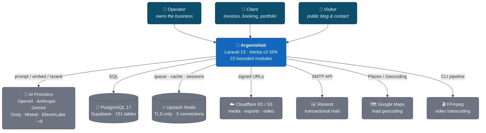
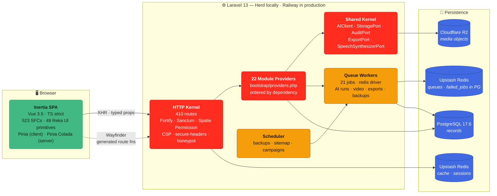
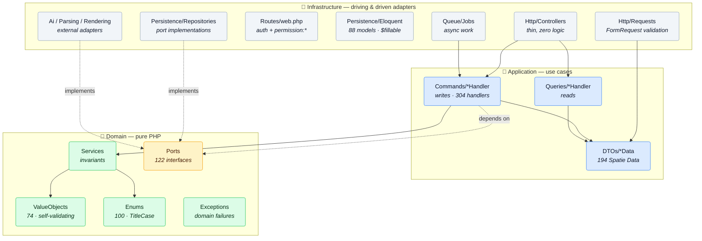
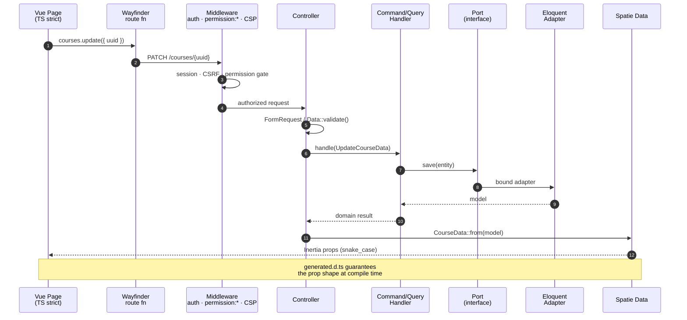
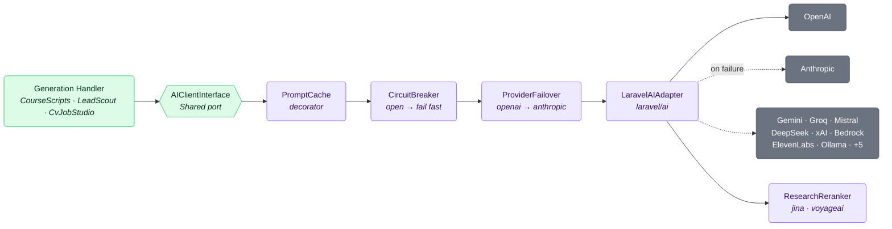
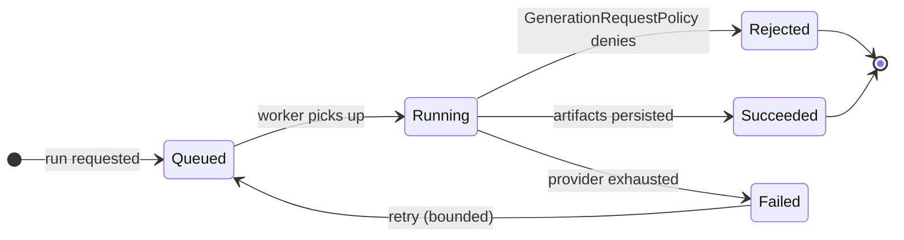
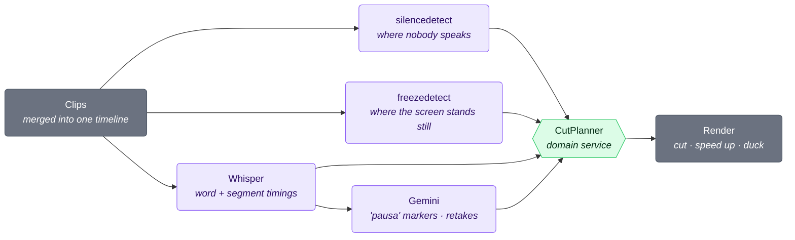
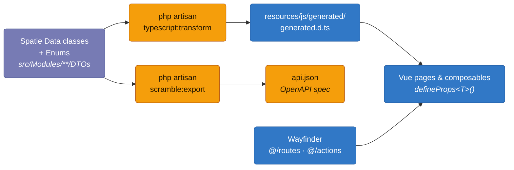

<div align="center">

# ArgenisHub

**A modular, hexagonal business operations platform — 22 bounded modules, one deployable monolith.**

Clients, invoicing, availability, content, campaigns, lead intelligence, CV/ATS tooling, AI course-script authoring and a video-editing pipeline, behind a single typed Inertia SPA.

🌐 **Live:** [argenis-hub-production.up.railway.app](https://argenis-hub-production.up.railway.app/)

<br />

<!-- ── Runtime ─────────────────────────────────────────────── -->
[](https://www.php.net/releases/8.5/en.php)
[](https://laravel.com)
[](https://www.postgresql.org)

<!-- ── Frontend ────────────────────────────────────────────── -->
[](https://vuejs.org)
[](https://inertiajs.com)
[](https://www.typescriptlang.org)
[](https://tailwindcss.com)
[](https://vite.dev)

<!-- ── Quality gates ───────────────────────────────────────── -->
[](https://pestphp.com)
[](https://phpstan.org)
[](https://laravel.com/docs/pint)
[](#-conventions--quality-gates)

<!-- ── Delivery ────────────────────────────────────────────── -->
[](https://github.com/argenisdev692/argenis-hub/actions/workflows/tests.yml)
[](./LICENSE)

<!-- ── Project stats ───────────────────────────────────────── -->


</div>

---

## 📑 Table of Contents

| | | |
|---|---|---|
| [Overview](#-overview) | [System Context (C4-1)](#-system-context--c4-level-1) | [Containers (C4-2)](#-container-view--c4-level-2) |
| [Module Anatomy](#-module-anatomy--hexagonal-slice) | [Request Lifecycle](#-request-lifecycle) | [AI Pipeline](#-ai-generation-pipeline) |
| [Module Matrix](#-module-matrix) | [Design Patterns](#-design-patterns-in-use) | [Type Contract](#-the-type-contract) |
| [Getting Started](#-getting-started) | [Daily Commands](#-daily-commands) | [Quality Gates](#-conventions--quality-gates) |
| [CI/CD](#-cicd--continuous-integration) | [Security](#-security-posture) | [Data Lifecycle](#-data-lifecycle--privacy) |
| [AI Governance](#-ai-governance--human-in-the-loop) | [Accessibility](#-accessibility) | [Testing](#-testing-strategy) |
| [Architecture Decisions](#-architecture-decision-records) | [Module Checklist](#-module-completion-checklist) | [Smart Video Editing](#-smart-video-editing--videoedits) |
| [License](#-license) | | |

---

## 🎯 Overview

ArgenisHub is a **modular monolith**: one Laravel deployment, 22 independently-bootstrapped modules that
communicate through explicit contracts rather than shared internals. Each module owns its domain, its
persistence, its HTTP surface and its tests — and depends on the outside world only through **ports**
declared in `src/Shared/Domain/Ports/`.

> **Why a modular monolith and not microservices?**
> This is a single-operator product. Microservices would buy independent deploys at the cost of network
> partitions, distributed transactions and 22 CI pipelines. Module boundaries give ~90% of the
> decoupling benefit at ~5% of the operational cost — and every boundary here is a **compile-time**
> boundary (PSR-4 namespace + service provider), so promoting a module to its own service later is a
> mechanical extraction, not a rewrite.

**Architectural pillars**

| Pillar | Implementation |
|---|---|
| **Hexagonal (Ports & Adapters)** | `Domain/Ports/` declares interfaces · `Infrastructure/` supplies adapters · the domain never imports Laravel |
| **CQRS-lite** | `Application/Commands/*Handler` mutate · `Application/Queries/*Handler` read · no command bus overhead |
| **DTO-first contracts** | Spatie `Data` objects are the *only* response shape — Inertia props and JSON share one class |
| **Generated types** | `php artisan typescript:transform` emits 2 577 lines of frontend types from those same `Data` classes |
| **Resilience by default** | Circuit breaker + multi-provider failover in front of every AI call |
| **Auditability** | `LogsActivity` on every aggregate, explicit `logOnly([...])`, never secrets |

---

## 🌍 System Context — C4 Level 1



---

## 🧱 Container View — C4 Level 2



### Why Redis is not optional

Upstash bills **per command**, and an idle queue worker still polls. That single fact shapes three
decisions, each documented inline where it lives:

| Constraint | Consequence in this codebase |
|---|---|
| **Serverless, TLS-only** | `REDIS_HOST="tls://<endpoint>.upstash.io"` — the scheme is in the host. Adding a `scheme` option as well makes `PhpRedisConnector` throw, because it disagrees about how to dial the socket |
| **Only database `0` exists** | Laravel ships `REDIS_CACHE_DB=1`, which Upstash rejects. So `REDIS_DB`, `REDIS_CACHE_DB` and `REDIS_QUEUE_DB` are all pinned to `0` and logical separation rests entirely on key prefixes — **the prefixes are load-bearing, not cosmetic** |
| **Per-command billing** | The `video-edits` queue sets `block_for => 5` deliberately; the default Redis queue leaves it `null`, because `block_for = 0` blocks `SIGTERM` and workers cannot drain on deploy |

**Key prefixes**, derived from `APP_NAME` so they are correct without configuration — but they are a
safety net, not a contract, so set `REDIS_PREFIX` / `REDIS_QUEUE_PREFIX` explicitly if two
environments ever share an instance:

| Connection | Used by | Prefix |
|---|---|---|
| `default` | Sessions (`SESSION_CONNECTION=default`) | `argenishub-database-` |
| `cache` | `CACHE_STORE=redis` | `argenishub-cache-` |
| `queue` | `QUEUE_CONNECTION=redis` | `argenishub-<env>-queue-` |

> `config/database.php` states the intent that *each environment points `REDIS_QUEUE_*` at its own
> Upstash database*. When `REDIS_QUEUE_HOST` / `REDIS_QUEUE_PASSWORD` are unset the queue falls back
> to `REDIS_HOST` / `REDIS_PASSWORD` and dev and prod share a keyspace, separated only by the `APP_ENV`
> segment above. Set them explicitly per environment if that separation matters to you.

Failed jobs are the exception to "everything is Redis": `QUEUE_FAILED_DRIVER=database-uuids` writes to
PostgreSQL, which is the right call — they are records you need to inspect, not ephemeral state.

---

## ⬡ Module Anatomy — Hexagonal Slice

Every module under `src/Modules/{Module}/` follows the same four-ring layout. Dependencies point
**inward only**: `Infrastructure → Application → Domain`. The domain ring has zero framework imports.



**The rule that keeps it honest:** an arrow may never point from `Domain` to `Infrastructure`.
Handlers depend on the *port*; the service provider binds the adapter. That is the whole trick.

---

## 🔄 Request Lifecycle

From a click in the SPA to typed props back on the page — no untyped hop anywhere in the chain.



---

## 🤖 AI Generation Pipeline

AI is a *driven adapter*, never a dependency of the domain. 15 providers are configured; failover and
circuit breaking are transparent to the handler that asked for a completion.





---

## 🎬 Smart Video Editing — VideoEdits

VideoEdits turns raw screen recordings into tutorial-ready cuts. Every signal below becomes a
**decision**; the `CutPlanner` domain service is the only place that turns decisions into cuts,
sped-up ranges and turned-down breaths, and the FFmpeg adapter only ever sees validated numbers.



### AI-tool wait detection — speed up, never jump-cut

A silence while the **screen keeps changing** is someone waiting on a tool: Claude or ChatGPT
streaming an answer, a Cursor agent editing files, Copilot filling a Word document. Cutting that
wait makes the result snap into place and loses the viewer. Detection is by **picture change**, not
by recognising an app, so it works with any tool.

| Silence + screen | Classified as | What the render does |
|---|---|---|
| Screen **moving** ≥ 50 % of the silence | Tool wait | Keeps the first 1.5 s and last 1 s at normal speed; plays the middle at **3×** (picture and room tone), never longer than **4 s** on screen |
| Screen moving, wait under ~3 s | Short tool wait | Kept exactly as recorded |
| Screen **still** | Dead air | Cut, as before |

- `freezedetect` runs on a 480p, audio-less copy, so the extra pass is cheap; a blinking caret
  changes too few pixels to count as activity.
- Each silence carries a `screen_activity` ratio (0–1) as decision evidence, visible in the report.
- A failed detection pass never fails the edit — every silence is simply cut as before.
- The report adds *"N tool wait(s) with a busy screen were sped up instead of cut."*

### Speech-aware cutting

| Fix | Behaviour | Needs a transcript |
|---|---|:---:|
| **Word guards** | A silence cut never reaches within 150 ms after / 60 ms before a word Whisper heard; a quiet word inside a "silence" splits the cut in two | ✅ |
| **Asymmetric padding** | 250 ms kept after speech, 100 ms before it — Spanish words fade out on an unstressed syllable | — |
| **Sentence-aware pauses** | A pause cut mid-sentence keeps 300 ms of air; a pause after `.` `?` `!` is cut tight | ✅ |
| **Breath ducking** | Gaps between words (breath, lip noise) are turned down **−15 dB** with 60 ms ramps — never cut, so the voice keeps its rhythm | ✅ |
| **Verbatim Whisper prompt** | A per-language style prompt with hesitations in it, so Whisper transcribes the "eh" / "mmm" it would otherwise tidy away — and speech cleanup can remove them | ✅ |
| **Click-free joins** | 15 ms audio fade at every join | — |

"Needs a transcript" means the edit runs with speech cleanup or AI edit enabled; a silence-only
edit still reuses a transcript already stored for the same clips.

### Configuration

All values live in `config/video-edit.php`; the switches are also environment variables.

| Key | Default | Purpose |
|---|---|---|
| `VIDEO_EDIT_SCREEN_ACTIVITY` | `true` | Tool-wait detection on / off |
| `VIDEO_EDIT_BREATHS` | `true` | Breath ducking on / off |
| `screen_activity.min_activity_ratio` | `0.5` | Share of the silence the screen must move |
| `screen_activity.speed` · `max_compressed_output_ms` | `3.0` · `4000` | Speed-up and on-screen cap |
| `silence.noise_floor_db` | `-40` | Must sit above the room noise — measure with `volumedetect`, use `mean − 12` |
| `silence.mid_sentence_pause_ms` | `300` | Air kept inside a sentence |
| `breaths.attenuation_db` | `-15` | How far breaths are turned down |

Verified by **520 module tests** and by rendering a real clip through FFmpeg: a 5 s wait at 3× came out
at exactly 1.67 s, and a ducked breath measured −15.0 dB against the surrounding audio.

---

## 📦 Module Matrix

22 service providers boot in **dependency order** (see `bootstrap/providers.php` — the ordering comments
there are load-bearing, not decorative). The `Tests` column counts test **files**; a single file holds
many cases (VideoEdits alone runs 520).

| Module | Responsibility | PHP files | Tests |
|---|---|--:|--:|
| 🔐 **Auth** | Fortify, passkeys, 2FA, OTP, session security | 58 | — |
| 🛡️ **Authorization** | Spatie roles/permissions — backs every `permission:*` gate | 47 | 7 |
| 🏢 **Company** | Tenant identity, branding, country → emits `CompanyCountryChanged` | 32 | — |
| 📅 **Availability** | Booking windows; listens for country changes | 56 | 6 |
| 🛎️ **Services** | Service catalogue | 24 | — |
| 👥 **Clients** | Client records and relationships | 20 | — |
| 📨 **ContactSupport** | Public contact funnel, honeypot-guarded | 29 | — |
| 🖼️ **Portfolios** | Public work showcase | 27 | — |
| ✍️ **Blog** | Categories and taxonomy | 32 | 6 |
| 📝 **Post** | Authoring, TipTap content, publishing | 90 | 13 |
| 📱 **SocialMedia** | Channel accounts and distribution | 80 | 14 |
| 📣 **Campaigns** | Outbound campaign orchestration | 73 | 7 |
| 📄 **Cvs** | CV storage and rendering | 33 | 6 |
| 🎯 **CvJobStudio** | ATS scoring, job matching, AI rewrite | 311 | 26 |
| 🧾 **Products** | Billable catalogue — boots before Invoices | 21 | 1 |
| 🏦 **PaymentAccounts** | Issuer accounts snapshotted onto invoices | 19 | 1 |
| 💰 **Invoices** | Issuing, line items, PDF export | 59 | 12 |
| 🔍 **LeadScout** | Lead discovery, geocoding, AI enrichment | 357 | 43 |
| 📜 **ActivityLog** | Cross-module audit trail surface, nightly archival | 14 | 1 |
| 💾 **Backups** | Scheduled backups via spatie/laravel-backup | 26 | 5 |
| 🎬 **VideoEdits** | FFmpeg pipeline, AI-tool wait detection, speech-aware cuts, breath ducking *(spec 001)* | 216 | 53 |
| 🎓 **CourseScripts** | AI course bibles, scripts, versioned deliverables *(spec 002)* | 210 | 25 |
| ⚙️ **Shared** | Ports, AI stack, resilience, export, storage, audit | — | — |

**Totals:** 1 911 PHP files · 122 ports · 306 handlers · 195 Spatie `Data` classes · 82 value objects ·
99 enums · 410 routes · 101 migrations · 523 Vue SFCs · 291 test files.

Specs for the four largest builds live in `specs/`:
`001-enterprise-auth` · `001-video-edit` · `002-course-scripts` · `003-lead-scout` · `004-cv-ats-job-studio`.

> Counts above are verified against the tree on every README change. If a badge and a
> paragraph disagree, the paragraph is wrong — regenerate rather than edit by hand.


---

## 🧩 Design Patterns in Use

| Pattern | Where | Why it earns its place |
|---|---|---|
| **Ports & Adapters** | `Domain/Ports/` (122) ↔ `Infrastructure/` | Domain stays framework-free and unit-testable without a database |
| **CQRS (lite)** | `Application/Commands` vs `Queries` (306 handlers) | Reads and writes evolve independently; no bus, no ceremony |
| **DTO / Data Transfer** | 195 Spatie `Data` classes | One class is validation + Inertia prop + JSON response + TS type |
| **Repository** | `Persistence/Repositories/` | Applied **only** where a second implementation or a DB-free test exists |
| **Value Object** | 82 VOs | Invariants enforced at construction — an invalid state can't be represented |
| **Domain Events + Listeners** | e.g. `CompanyCountryChanged` → Availability | Cross-module reaction without a cross-module import |
| **Circuit Breaker** | `Shared/Infrastructure/Resilience/CircuitBreaker` | A dead AI provider fails fast instead of exhausting workers |
| **Failover Chain** | `ProviderFailover` | `openai → anthropic` (configurable) on provider error |
| **Decorator** | `PromptCache` wrapping `AIClientInterface` | Caching added without touching a single handler |
| **Policy / Guard** | 7 Policies + `permission:*` middleware | Authorization at the route edge *and* the model edge |
| **Strategy** | `Http/Export` transformers (PDF / Word / Excel) | One export port, many renderers |
| **Job / Async Worker** | 21 queued jobs | Long AI and FFmpeg work never blocks a request |

---

## 🔗 The Type Contract

The single most important invariant in this codebase: **frontend types are generated, never written.**



Hand-writing a TS interface that mirrors a `Data` class is a **review failure** — it is exactly how
`any` and silent drift get in. `MapOutputName(SnakeCaseMapper::class)` is honoured by the generator,
so the snake_case wire contract survives the round trip.

---

## 🚀 Getting Started

### Prerequisites

| Requirement | Version | Note |
|---|---|---|
| PHP | **8.5** | Provided by Laravel Herd (native Windows — no Docker, no Sail, no WSL) |
| Composer | 2.x | |
| Node.js | 22+ | |
| PostgreSQL | 17.x | Supabase-hosted in this deployment |
| **Redis** | TLS endpoint | **Required** — `.env.example` ships `QUEUE_CONNECTION`/`CACHE_STORE`/`SESSION_DRIVER` = `redis`. Needs the `phpredis` **PHP extension** (already in Herd) and a reachable server; Upstash works as-is |
| FFmpeg | on `PATH` | Required by the VideoEdits module |

> **Redis is not optional here.** `.env.example` defaults all three of cache, sessions and queue to
> the `redis` driver, so `composer setup` completes happily and then fails at the first request if no
> Redis is reachable. Either point `REDIS_HOST` at a local Redis or at your Upstash endpoint, or
> override the three drivers to `database` for local work.

### Install

```bash
git clone <repository-url> argenis-hub
cd argenis-hub

composer setup      # install → .env → key:generate → migrate → npm install → npm run build
```

`composer setup` is idempotent. If you prefer the manual path:

```bash
composer install
cp .env.example .env
php artisan key:generate
php artisan migrate
npm install && npm run build
```

### Configure

Fill these in `.env` before first boot:

```dotenv
APP_NAME=ArgenisHub
APP_URL=https://argenis-hub.test        # Herd serves the folder name as .test

DB_CONNECTION=pgsql                     # host / port / credentials from your PG or Supabase project

# Cache, sessions and queue all run on Redis. Upstash is TLS-only: put the scheme
# in the host and do NOT add a separate scheme option (PhpRedisConnector throws).
REDIS_CLIENT=phpredis
REDIS_HOST=tls://<endpoint>.upstash.io
REDIS_PASSWORD=
REDIS_PORT=6379
REDIS_DB=0                             # Upstash has ONLY database 0
REDIS_CACHE_DB=0                       #   ↑ default of 1 is rejected by Upstash
REDIS_QUEUE_DB=0                       #   ↑ logical separation comes from key prefixes
# Per-environment isolation — set these instead of relying on the APP_NAME-derived defaults:
# REDIS_QUEUE_HOST=                      # falls back to REDIS_HOST when unset
# REDIS_QUEUE_PASSWORD=
# REDIS_PREFIX=argenishub-database-
# REDIS_QUEUE_PREFIX=argenishub-local-queue-

AI_PROVIDER=openai                      # default provider
AI_FAILOVER_ORDER=openai,anthropic      # ordered failover chain
OPENAI_API_KEY=                         # image + embeddings
ANTHROPIC_API_KEY=
GEMINI_API_KEY=                         # also used by VideoEdits for transcription
VIDEO_EDIT_TRANSCRIPTION_PROVIDER=gemini # gemini (verbatim + word timings) or openai (whisper-1)
VIDEO_EDIT_GEMINI_TRANSCRIBE_MODEL=gemini-3.5-transcribe
VIDEO_EDIT_SPEECH_LANGUAGE=es           # optional — recordings are Spanish-first
VIDEO_EDIT_SCREEN_ACTIVITY=true         # optional — speed up AI-tool waits instead of cutting them
VIDEO_EDIT_BREATHS=true                 # optional — turn breaths down between words

FILESYSTEM_DISK=r2                      # Cloudflare R2 (S3-compatible)
RESEND_API_KEY=                         # transactional mail
GOOGLE_MAPS_API_KEY=                    # LeadScout geocoding
```

### Run

```bash
composer dev
```

One command, **five** processes — `server`, `queue`, `video-queue`, `scheduler`, `vite` — colour-coded
in a single terminal. The two queue workers are not redundant: `queue` drains
`lead-scout,lead-scout-llm,studio,default`, while `video-queue` drains `video-edits` on its own Redis
connection with `--memory=1024`, because an FFmpeg render is not something you want sharing a worker
with a LeadScout enrichment run. The app is served by Herd at your `APP_URL`.

---

## ⌨️ Daily Commands

<table>
<tr><th align="left">Intent</th><th align="left">Command</th></tr>
<tr><td>Full dev stack</td><td><code>composer dev</code> <i>(5 processes: server · 2 queue workers · scheduler · vite)</i></td></tr>
<tr><td>Inspect / retry the queue</td><td><code>php artisan queue:monitor default,video-edits</code> · <code>queue:failed</code> · <code>queue:retry &lt;id&gt;</code></td></tr>
<tr><td>Run one module's tests</td><td><code>php artisan test --compact src/Modules/{Module}</code></td></tr>
<tr><td>Filter a single test</td><td><code>php artisan test --compact --filter=createsCourse</code></td></tr>
<tr><td>Format changed PHP</td><td><code>vendor/bin/pint --dirty --format agent</code></td></tr>
<tr><td>CI gate (format check)</td><td><code>vendor/bin/pint --test</code></td></tr>
<tr><td>Static analysis</td><td><code>composer types:check</code> <i>(larastan level 7 — scoped to <code>app/ config/ database/ routes/</code>)</i></td></tr>
<tr><td>TypeScript check</td><td><code>npm run types:check</code> <i>(vue-tsc --noEmit)</i></td></tr>
<tr><td>Lint JS/Vue</td><td><code>npm run lint</code> · <code>npm run format</code></td></tr>
<tr><td>Regenerate frontend types</td><td><code>php artisan typescript:transform</code></td></tr>
<tr><td>Export OpenAPI spec</td><td><code>php artisan scramble:export</code> → <code>api.json</code></td></tr>
<tr><td>Export a bounded-context spec</td><td><code>php artisan scramble:export --api=video-edits</code> → <code>api-video-edits.json</code></td></tr>
<tr><td>Browse the API</td><td><code>/docs/api</code> <i>(Scramble UI, per context)</i></td></tr>
<tr><td>Inspect routes</td><td><code>php artisan route:list --except-vendor</code></td></tr>
<tr><td>Inspect schema</td><td><code>php artisan db:show</code> · <code>php artisan db:table {table}</code></td></tr>
<tr><td>Everything CI runs</td><td><code>composer ci:check</code></td></tr>
</table>

> ⚠️ **Never** run the bare full suite casually — it is slow. Scope it to the module you touched.

---

## ✅ Conventions & Quality Gates

**PHP 8.5**
- Constructor property promotion; no empty zero-arg constructors
- Explicit return types and parameter type hints on **every** method
- Curly braces always, even for one-line bodies
- `TitleCase` enum cases; PHPDoc array shapes over inline comments
- Every model declares `$fillable`; `Model::shouldBeStrict()` is on in `AppServiceProvider`

**N+1 is a defect, not a performance note**
- `with('rel:id,fk,col')` with explicit columns on every list query
- `withCount()` / `withSum()` / `withWhereHas()` instead of in-loop queries
- `beyondcode/laravel-query-detector` runs in dev

**TypeScript & Vue 3.5**
- `<script setup lang="ts">` everywhere; no Options API in new code
- **Zero `any`** — no `as any`, no `@ts-ignore`, no unlinked `@ts-expect-error`; use `unknown` + a guard
- `useTemplateRef<T>()`, `useId()`, `defineModel<T>()`, `defineSlots<T>()`, `onWatcherCleanup()`
- `withDefaults` is banned — use destructured props with defaults
- **Server state → Pinia Colada** (`staleTime` + `gcTime` on every query). **Client state → Pinia**. Never mixed.
- No hardcoded colours — `var(--token)` only, tokens defined in `resources/css/globals.css`

---

## 🔒 Security Posture

| Control | Implementation |
|---|---|
| Authentication | Laravel Fortify · passkeys (WebAuthn) · TOTP 2FA · one-time passwords |
| Password hashing | Argon2id (`config/hashing.php`) |
| Authorization | `auth` middleware + Spatie `permission:*` on every route; Policies on models |
| Frontend gating | UI checks **permissions**, never roles |
| Route binding | UUID routes pinned with `->whereUuid('uuid')` |
| Headers | Spatie CSP + `bepsvpt/secure-headers` |
| Spam | `spatie/laravel-honeypot` on public forms |
| Uploads | MIME + size + extension validated; R2 access via **signed URLs only** |
| Audit | `LogsActivity` with explicit `logOnly([...])`, `logOnlyDirty()`, `dontLogEmptyChanges()` — never secrets or PII |
| API | Sanctum tokens; OpenAPI surface generated by Scramble |
| Production | `APP_DEBUG=false` — no stack traces, SQL or paths leaked |

Baseline: **OWASP Top 10 (2025)** + **API Top 10 (2023)** + **LLM Top 10 (2025)**, adapted to
Laravel 13 + Vue 3 + Inertia v3. The full checklist lives in `.claude/OWASP/SKILL.md`.

---

## 🔁 CI/CD — Continuous Integration

Every push to `main` and every pull request runs the same gate a reviewer would run by hand.
`.github/workflows/tests.yml` — one job, `ubuntu-latest`, PHP **8.5** + Node **22**.

```
composer setup          # install → .env → key:generate → migrate → build
composer ci:check       # the gate
```

`composer ci:check` is ordered cheapest-first, so a formatting slip fails in seconds rather than
after the suite has run:

| Step | Command | Catches |
|---|---|---|
| 1 | `npm run lint:check` (ESLint 9 flat config) | Unused vars, missing deps, Vue rule violations |
| 2 | `npm run format:check` (Prettier) | Formatting drift |
| 3 | `npm run types:check` (`vue-tsc --noEmit`) | Type errors across all 523 SFCs |
| 4 | `vendor/bin/pint --parallel --test` | PHP style |
| 5 | `composer types:check` (Larastan **level 7**) | Static analysis |
| 6 | `php artisan test` (Pest 5, full suite) | Behaviour |

**Supply-chain hygiene** — the part most READMEs omit:

- `permissions: contents: read` — the job cannot write to the repo.
- `persist-credentials: false` — the checkout token is not left in `.git/config`.
- Every action is **pinned to a full commit SHA**, not a floating tag, so a compromised upstream
  release cannot land in this pipeline.
- `AWS_EC2_METADATA_DISABLED`, empty API keys and inert storage credentials are forced in
  `phpunit.xml`, so the suite can never issue a real, billed HTTP call or reach instance metadata.

**Dependabot** (`.github/dependabot.yml`) watches `composer` and `npm` for security updates.

---

## 🗄️ Data Lifecycle & Privacy

This system handles **client speech, invoices and video recordings**. Retention is a feature, not an
afterthought — every artefact has an owner, a lifetime and a deletion path.

| Artefact | Lifetime | Deletion path |
|---|---|---|
| Uploaded media (source files) | `retention.failed_sources_hours` — **24 h** after a failed edit | `video-edits:purge-sources` |
| Abandoned drafts | `retention.draft_hours` — **24 h** | Sweep deletes them outright |
| Unanswered cut reviews | `retention.review_hours` — **24 h**, then resolved as **"keep everything"** | Sweep resolves and renders |
| Extracted speech + workspace files | Until the edit's processing ends | FR-18 wipe, with the workspace |
| Transcripts | Bound to their edit by FK **cascade** | Deleting the edit deletes the speech |
| Presigned upload URLs | `upload_ttl_minutes` — **60 min** | Expire by signature |
| Presigned download URLs | `download_ttl_minutes` — **15 min** | Expire by signature |
| Activity log | Nightly archival (`activity-log:archive`) | Retention policy |
| Backups | 7 daily / 16 daily / 8 weekly / 4 monthly / 2 yearly | `keep_*` policies |
| LeadScout source markdown | `markdown_retention_days` — **30 d** | Scheduled prune |

Three properties worth calling out, because they are the ones usually got wrong:

1. **A transcript is personal data, so it is never cached globally.** `video_edit_transcripts` is
   keyed `UNIQUE` per edit and cascade-deleted with it. Reuse only ever reads a *previous edit of the
   same user* with matching source fingerprints — matching across accounts would hand one user's
   speech into another's video.
2. **Expired review resolves to "keep everything", not "delete".** When an owner never answers, the
   safe default is the original footage, not a silent destructive edit.
3. **Reuse is keyed by provider and model as well as by content.** Word timings are model-specific, so
   a transcript is only reusable by the transcriber that produced it — otherwise a cached copy would
   silently move every cut in the timeline.

---

## 🧑‍⚖️ AI Governance — Human in the Loop

Fifteen providers are wired behind one port. What keeps that from being reckless is a consent gate, a
review gate, and a cost meter — all three enforced in the Application layer, not by convention.

| Control | Mechanism |
|---|---|
| **Explicit consent** | `ai_consent_at` on the edit; no consent ⇒ `AiConsentRequiredException`, the model is never called |
| **AI never cuts unilaterally** | Every AI proposal parks the edit in `awaiting_review`; the render cannot run around an open review (`CutReviewRequiredException`) |
| **Confidence-aware pre-selection** | Proposals ≥ `VIDEO_EDIT_AI_MIN_CONFIDENCE` (0.8) arrive pre-ticked; weaker ones arrive **unticked and visible**, never discarded |
| **Bounded retries** | `Failed → Queued` is bounded; an exhausted provider chain ends the run, it does not spin |
| **Fail fast** | `CircuitBreaker` opens on a dead provider instead of burning worker time |
| **Ordered failover** | `ProviderFailover` walks a configured chain (`openai → anthropic`) |
| **Cost control** | `MeteredAiCall` enforces per-purpose LLM budgets; `PromptCache` decorator reuses long-lived prompt layers |
| **No raw responses persisted** | Only parsed recommendations are stored — provider payloads, which can echo user content, are discarded after parsing |
| **Refuse rather than guess** | Unknown transcription provider throws; a misspelled config is never silently defaulted |

This is the **LLM Top 10 (2025)** baseline applied concretely: excessive agency is prevented by the
review gate, sensitive-information disclosure by never logging payloads, and unbounded consumption by
the circuit breaker plus the meter.

---

## ♿ Accessibility

Accessibility is enforced in the component layer rather than audited after the fact:

- **49 Reka UI primitives** in `components/ui` — headless, ARIA-correct building blocks (dialog, combobox,
  menu, tabs, toast, drawer, stepper…), styled once through design tokens.
- **Mobile-first** on every component; layout is fluid before it is fixed.
- **Design tokens only** — no hardcoded colours anywhere; `resources/css/globals.css` is the single
  source, and dark mode is one class on `<html>`.
- **Semantic tokens** carry meaning, so a palette change is not a contrast audit.
- Keyboard paths come from the primitives rather than being re-implemented per page.

> **Honest status:** these are the practices that make WCAG AA conformance *achievable*, and no
> third-party accessibility audit has been performed yet. Treat AA as a target under verification, not
> as a certified claim.

---

## 🧭 Architecture Decision Records

The load-bearing decisions, and what each one cost. Full context lives in `.claude/` and `specs/`.

| # | Decision | Alternative rejected | Why |
|---|---|---|---|
| 1 | **Modular monolith**, one deployment | Microservices | One operator. Boundaries are *compile-time* (namespace + provider), so extraction is mechanical, not a rewrite |
| 2 | **Ports & Adapters with `Domain/Ports/`** | Direct Eloquent in handlers | The domain ring imports no framework, so invariants are unit-testable without a database |
| 3 | **Spatie `Data` as the only response shape** | `JsonResource` | One class *is* the validator, the Inertia prop, the JSON response and the TS type |
| 4 | **Frontend types generated, never written** | Hand-maintained interfaces | A mirrored interface is exactly how `any` and silent drift get in |
| 5 | **Repositories only where earned** | Repository everywhere | Applied where a second implementation or a DB-free test exists — a one-implementation port is boilerplate, not DIP |
| 6 | **Gemini `verbatim` for transcription** | whisper-1 (the old default) | Whisper normalises fillers away; only Gemini returns word offsets *and* keeps the hesitations the cutters need |
| 7 | **Consent + review gates on AI output** | Auto-apply AI cuts | Deleting a take the owner wanted is not recoverable from a rendered file |

---

## 🧪 Testing Strategy

**Pest 5**, 291 test files, colocated with the code they cover.

```
src/Modules/{Module}/Tests/
├── Feature/     # HTTP, authorization, end-to-end use cases  ← the majority
├── Unit/        # value objects, domain services, pure logic
├── Fixtures/    # canned payloads and provider responses
└── Support/     # module-local helpers and fakes

tests/           # 65 cross-cutting application tests
```

```bash
php artisan test --compact src/Modules/LeadScout      # one module
php artisan test --compact --filter=rejectsRun        # one behaviour
```

Every change ships with a test — new or updated. Models in tests come from **factories**
(check for custom states first). Tests are never deleted without approval.

---

## 📋 Module Completion Checklist

A backend module is not "done" when the tests pass. It is done when this pipeline has actually run,
in this order, with the real output read:

```bash
php artisan test --compact src/Modules/{Module}   # ← must be green FIRST

php artisan optimize:clear                        # flush config/route/view/event caches
php artisan ide-helper:generate                   # facade helpers
php artisan ide-helper:models --write             # model docblocks
php artisan typescript:transform                  # regenerate generated.d.ts
vendor/bin/pint                                   # format everything
vendor/bin/pint --test                            # CI gate — must exit 0
php artisan scramble:clear                        # invalidate cached spec
php artisan scramble:export                       # write api.json
php artisan scramble:cache                        # warm the spec
```

If a finalization step changes code, **re-run the module's tests**. Then re-index the code graph
(`index_repository`, `mode: "full"`) — until that runs, new classes, ports and routes do not exist
for the next session's tooling.

---

## 🗂️ Repository Layout

```
argenis-hub/
├── app/                      # Laravel plumbing only (providers, kernel-level glue)
├── src/
│   ├── Modules/{Module}/     # 22 bounded contexts — Domain · Application · Infrastructure · Tests
│   └── Shared/               # ports, AI stack, resilience, export, storage, audit, middleware
├── resources/
│   ├── js/
│   │   ├── pages/            # Inertia page components
│   │   ├── modules/          # 25 feature folders (composables, schemas, types)
│   │   ├── components/ui/   # 49 Reka UI primitives (shadcn-vue new-york-v4)
│   │   ├── generated/        # generated.d.ts — DO NOT EDIT
│   │   ├── routes/ actions/  # Wayfinder output — DO NOT EDIT
│   │   └── common/ lib/      # forms, http client, utilities
│   └── css/globals.css       # design tokens — the only place colours are defined
├── routes/                   # web · api · settings · console (modules mount their own)
├── database/migrations/      # 101 migrations
├── specs/                    # spec-driven-development artefacts per major build
├── config/                   # 35 config files incl. ai · scramble · csp · secure-headers
├── .github/workflows/        # CI: tests.yml
├── api*.json                 # exported OpenAPI specs (default + per bounded context)
└── LICENSE                   # MIT
```

---

## 📄 License

**MIT** — see [`LICENSE`](./LICENSE).

```
composer.json  →  "license": "MIT"
```

---

<div align="center">

**ArgenisHub** — hexagonal by construction, typed end to end, audited by default.

<sub>MIT licensed · Architecture rules in <code>.claude/rules/rules.md</code> · skills in <code>.claude/</code> · specs in <code>specs/</code></sub>

</div>
